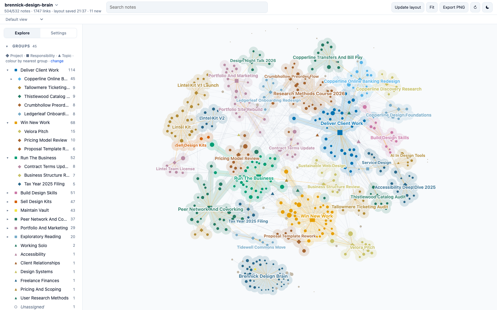

# Brennick Design Brain

A demo Second Brain: about 530 linked Markdown notes holding the working memory of a fictional freelance product designer. Clone it, open the folder, and explore what a vault looks like after two years of daily use: client projects, proposals, invoices and taxes, a product on the side, courses, peers, decisions, open questions, and the links between them.



**[Explore this vault in the live demo](https://mfoll.github.io/brain-graph-demo/?vault=brennick-design-brain)**: its map in Brain Graph, in your browser, with nothing to install.

> [!warning]
> Everything about the practice is fictional: Talia Brennick, every client, peer and adviser, Copperline Credit Union, Orchard & Vane, Velora Mobility, Lintel Kit, Tidewell Commons, the courses, fees, test scores and results. Any resemblance to real people or organisations is accidental. Only the Sources marked as Wikipedia articles, documentation or standards are real.

## What it shows

The vault was deployed from the [Second Brain template](https://github.com/mfoll/second-brain-template), which adds operating rules, workflows and a decision record to the [Portent](https://github.com/refactoringhq/portent) note model. Everything is plain files: Markdown notes with YAML frontmatter, typed relationships (`belongs_to`, `related_to`, `has`) and wikilinks. No app, database or index is required.

| Area | What to look at |
| --- | --- |
| Structure | 8 Responsibilities at the root, 25 Projects under them, 10 Topics as lateral context; every note rolls up to a Responsibility. |
| Memory | About 180 Sources, 50 Events, 35 Questions, 30 Concepts, 15 Opinions, 15 Recaps, 40 people. |
| Real material | About 60 Sources are real public pages: Wikipedia articles on design methods, usability, accessibility, freelancing and pricing, and official documentation of WCAG and design tools, cited with title, URL and access date and summarised in our own words. Their "Why It Matters" sections describe how the fictional designer uses them. |
| Operations | `AGENTS.md`, Type notes, Procedures, Skills and ADRs from the template, unchanged except for the deployment steps. |
| History | Git history from January 2025 to October 2026, one commit for each month that had captures. |

## Open it

- **Any Markdown editor.** Clone the repository and open the folder; notes sit flat at the root by design. Start from [vault](vault.md).
- **[Tolaria](https://tolaria.md/).** Open the folder as a vault for typed sidebars, relationship panels and saved views.
- **[Brain Graph](https://github.com/mfoll/brain-graph).** See the whole vault as a map colored by project:

  ```bash
  npx github:mfoll/brain-graph path/to/second-brain-demo-freelancer
  ```

- **A coding agent.** Run Claude Code, Codex or Gemini CLI in the folder. They read [AGENTS](AGENTS.md) (through `CLAUDE.md` and `GEMINI.md` where needed) and follow the vault's Procedures.

## Try this

Each question has a known answer in the vault, so you can check what an agent finds.

| Ask | Where the answer lives |
| --- | --- |
| Why did I stop quoting day rates, and when do I still use them? | A decision on 2025-11-20 retired them; a check-in on 2026-06-18 brought them back for small work. See [pricing-model-review](pricing-model-review.md) and [pricing-check-in-2026-06-18](pricing-check-in-2026-06-18.md). |
| What did I learn from losing the Velora pitch? | Three reasons from the client's feedback call, and three changes. See [velora-feedback-call-2026-06-03](velora-feedback-call-2026-06-03.md) and [proposal-template-rework](proposal-template-rework.md). |
| Why does the Copperline palette have two teals? | An accessibility review on 2026-02-11, with the brand director still disagreeing. See [copperline-accessibility-review-2026-02-11](copperline-accessibility-review-2026-02-11.md). |
| How much of each payment do I set aside for taxes, and why? | The rate changed after the 2025 return. See [set-aside-taxes-from-each-payment](set-aside-taxes-from-each-payment.md). |
| Should Lintel Kit get a team license? | Still open. See [should-lintel-kit-get-a-team-license](should-lintel-kit-get-a-team-license.md). |
| Why do new contracts ask for a 50% deposit? | One client paid 67 days late. See [contract-terms-update](contract-terms-update.md). |

Workflows to try with an agent:

- **Resume a project:** "Resume the Copperline Online Banking Redesign."
- **Process the Inbox:** about eight raw captures from the week before 23 October 2026 have `_organized: false`; each has an obvious home.
- **Ingest a page:** give any Wikipedia article on usability, accessibility or freelancing and ask where it belongs.
- **Lint the vault:** the audits should report one link to a missing note and one Concept that belongs to nothing, both left in on purpose. Informational lines, such as external contacts without a parent, are expected.

## Scope and privacy

The fictional designer's client work, new business, business administration, portfolio, product, learning and peer network. No client confidential material, research participant identities, bank or tax identifiers, credentials or private life; client deliverables are described and pointed to through Source notes, never copied.

## Template updates

The vault was deployed from the template on 2026-10-23. Later template improvements can be brought in with [Upgrade an Existing Vault From the Template](upgrade-existing-vault-from-template.md), as a reviewed change: an agent proposes each change, and a person approves it. Never run it unattended. A vault in use is expected to differ from the template on purpose, in its ADRs, Procedures, Skills and instructions.

## How it was made

An AI agent drafted the world specification (the designer, clients, people, projects, timeline and the storylines behind the questions above) and a person reviewed and changed it. AI agents then wrote the notes from it, one per area of the practice, and retrieved the real articles from Wikipedia and the documentation sites. The links, frontmatter, cross-area consistency and source metadata were checked with the template's lint scripts and against Wikipedia and the live documentation pages.

## Storage and backup

The notes are plain files, and their history is this Git repository. To undo edits made while trying the demo, run `git checkout .`; `git clean -n` lists any new files, which `git clean -f` would delete.

## More example vaults

This is one of nine fictional vaults deployed from the same template, each kept by a different kind of person: a lab head, a café owner, a teacher, a freelance designer, a parent running a household, a sports club chair, a novelist, a start-up engineering lead and an HR assistant. The [template README](https://github.com/mfoll/second-brain-template#example-vaults) lists them all.

## Licence

MIT, see `LICENSE`, which also covers the template material. `THIRD_PARTY_NOTICES.txt` lists upstream notices. Cited Wikipedia articles and documentation pages remain under their own licences; the notes contain only their metadata and our own summaries.
